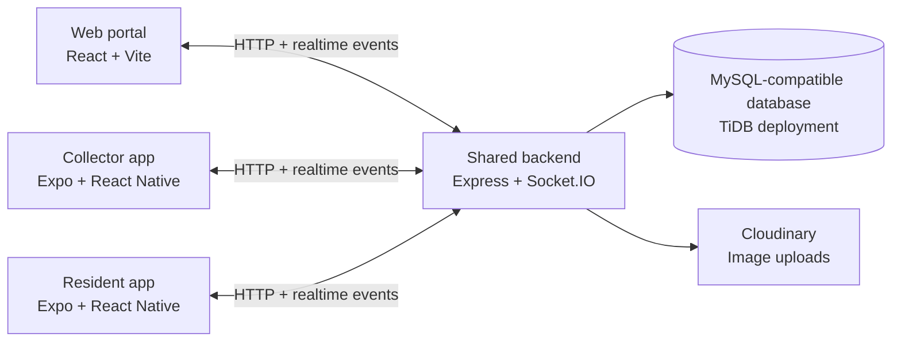

<div align="center">
  
  <h1>GreenWay</h1>
  <p><strong>Waste collection operations. Connected community services.</strong></p>
  <p>A waste management platform for Candelaria, Quezon, Philippines.</p>
  <p>
    <a href="#platform">Platform</a> ·
    <a href="#architecture">Architecture</a> ·
    <a href="#getting-started">Getting started</a> ·
    <a href="#deployment">Deployment</a> ·
    <a href="#documentation">Documentation</a>
  </p>
</div>

---

GreenWay brings collection planning, truck tracking, waste reporting, and community information into a shared system. Its web portal serves administrators, collectors, and residents through role-specific workflows backed by an Express API, a MySQL-compatible database, and Socket.IO updates.

This README describes the source and configuration in this repository. It does not certify production availability, mobile release readiness, or a particular number of concurrent users.

## Platform

| Role | Web portal capabilities |
| --- | --- |
| **Administrator** | Manage residents, collectors, trucks, barangays, streets, routes, and calendar events. Review waste reports, monitor collection activity, publish posts and announcements, and inspect analytics and audit logs. |
| **Collector** | View assignments and schedules, operate collection runs, follow route stops, send GPS samples, review route history, and receive notifications. The API role name is `DRIVER`. |
| **Resident** | View collection schedules and authorized truck activity, submit waste reports with photos, follow report progress, browse community content, and manage profile and notification preferences. |

### Collection workflow

Routes define collection plans; dated runs preserve the operational record. Collectors start an assigned run, progress through its stops in order, and record collected or missed outcomes. The lifecycle also supports pauses, resumes, and early termination.

The backend validates GPS samples against the active assignment and run state. Residents receive location data scoped to their registered collection area. Run snapshots, stop outcomes, pause duration, and GPS history support later review. Collection-day boundaries use Philippine time; stored tracking instants use UTC.

See [tracking behavior and validation limits](server/docs/web-truck-tracking.md) for the detailed workflow. Use the [database guide](server/src/database/README.md) for the current installation procedure; older deployment notes in the tracking document refer to historical migrations.

## Architecture



| Layer | Technologies in the source |
| --- | --- |
| Web | React 18, TypeScript, Vite 5, Tailwind CSS, Radix UI, React Router, TanStack Query, Zustand, Leaflet, Recharts |
| API | Node.js, Express 5, Socket.IO, Zod, JWT, bcryptjs, mysql2 |
| Data and media | MySQL/TiDB-compatible SQL, Cloudinary image storage |
| Mobile | Expo SDK 52, React Native 0.76, Expo Router, TypeScript, MapLibre, Expo Location, SecureStore |
| Verification tools | Vitest, Testing Library, ESLint, TypeScript, Node.js test runner |

### Repository layout

```text
client/                 Web portal, shared UI, API clients, and web tests
server/
  src/modules/          Domain routes, controllers, services, and schemas
  src/sockets/          Realtime channels and authorization
  src/database/         SQL baseline, schema tests, and database guide
  scripts/              Database maintenance tools and their tests
  docs/                 Tracking behavior documentation
driverapp/              Collector mobile application, when included in checkout
residentapp/            Resident mobile application, when included in checkout
```

Each application has its own `package.json` and dependency lockfile. There is no root application package or root npm script. The mobile directories are present in the current working checkout but are not currently tracked in Git; their instructions apply to checkouts that include those directories.

## Getting started

### Prerequisites

- Git, Node.js, and npm. The repository does not pin a Node.js runtime version; use a version compatible with each application's locked dependencies.
- An empty MySQL/TiDB-compatible database with TLS connectivity. The current connection configuration requires certificate verification.
- Cloudinary credentials for image uploads.
- Private server environment values, including the email values currently required by startup validation.
- For native mobile development, the appropriate Android or iOS build toolchain and a native build containing MapLibre.

Commands below use PowerShell and start from the repository root unless stated otherwise.

### 1. Prepare the database

Read [the database installation guide](server/src/database/README.md), then import [`schema.sql`](server/src/database/schema.sql) into an **empty database**. The baseline contains structure, not accounts or sample records.

Provision the initial administrator privately using the guide's account requirements. After signing in, configure barangays, streets, trucks, and collectors through the admin portal.

The baseline is not an upgrade script for an existing database. Review structure differences, preserve a verified backup, and obtain authorization before applying maintenance or reset operations. The tools in `server/scripts/` include destructive maintenance actions; they are not part of routine application startup.

### 2. Configure and start the API

```powershell
cd server
npm ci
Copy-Item .env.example .env
```

The current server `.env.example` documents routing and retention options only. Add the settings below to your private `.env`, replacing every placeholder before starting the API:

```dotenv
PORT=3000
DB_HOST=your-database-host
DB_PORT=4000
DB_USER=your-database-user
DB_PASSWORD=your-private-database-password
DB_NAME=your-database-name
JWT_SECRET=your-generated-private-signing-secret
JWT_EXPIRES_IN=7d
CLOUDINARY_CLOUD_NAME=your-cloudinary-cloud-name
CLOUDINARY_API_KEY=your-cloudinary-api-key
CLOUDINARY_API_SECRET=your-private-cloudinary-api-secret
EMAIL_USER=your-private-email-user
EMAIL_PASS=your-private-email-password
CLIENT_URL=http://localhost:8080
APP_TIME_ZONE=Asia/Manila
```

`DB_PORT=4000` is a TiDB connection example; use your database endpoint's actual port. The database, JWT, Cloudinary, email, and `CLIENT_URL` values are checked at startup. `PORT` defaults to `3000`, and `APP_TIME_ZONE` defaults to `Asia/Manila`.

Generate a signing secret locally rather than reusing the placeholder:

```powershell
node -e "console.log(require('node:crypto').randomBytes(32).toString('hex'))"
```

Keep the result private. The active account recovery implementation uses recovery codes; the presence of `EMAIL_USER` and `EMAIL_PASS` in startup validation does not establish an email recovery workflow.

```powershell
npm run dev
```

The default API base URL is `http://localhost:3000/api`. Socket.IO connects to the server origin. `GET /health` reports that the HTTP service is running; it does not perform a database readiness query.

### 3. Configure and start the web portal

Open another terminal at the repository root:

```powershell
cd client
npm ci
Copy-Item .env.example .env.local
npm run dev
```

The local configuration is:

```dotenv
VITE_API_URL=http://localhost:3000/api
```

Vite is configured for port `8080`. Open the address printed by the development server, normally `http://localhost:8080`. The standard Socket.IO connection derives its server origin from `VITE_API_URL`. Some tracking consumers also support `VITE_SOCKET_URL`; keep HTTP and realtime traffic pointed at the same backend.

### 4. Mobile development

The collector and resident applications are separate development codebases. Install and configure each independently when its directory is included in your checkout:

```powershell
cd driverapp
npm ci
Copy-Item .env.example .env
```

Set `EXPO_PUBLIC_SERVER_HOST` to the API **origin**, without `/api` or a trailing slash:

```dotenv
EXPO_PUBLIC_SERVER_HOST=http://10.0.2.2:3000
```

This example targets an Android emulator using the API's default port. A physical device needs your development computer's reachable LAN address. For a deployed backend, use its HTTPS origin. The bundled mobile fallback addresses use port `2000`, so set this variable explicitly when your API runs on `3000`.

```powershell
npm run android
```

Repeat from `residentapp/` for the resident application. `npm run ios` requires a compatible macOS/iOS development environment. Because the apps include native MapLibre modules, use a native build with those modules rather than assuming Expo Go contains them. `npm start` starts the Expo development server; it does not create a native binary.

Mobile behavior requires separate device and shared-API verification. The collector store includes demo/offline fallback state, which must not be treated as proof of a server-confirmed assignment or active run. Background GPS operation is not established by the current foreground-location flow.

## Deployment

The project's hosting arrangement uses **Vercel for the web portal**, **Render for the API**, and **TiDB for the database**. Cloudinary handles uploaded images. The following settings match the source; live account configuration and service health have not been independently verified here.

| Service | Source-aligned configuration |
| --- | --- |
| **Vercel** | Root directory: `client`. Install: `npm ci`. Build: `npm run build`. Output: `dist`. Set `VITE_API_URL` to the deployed API's HTTPS `/api` URL before building. |
| **Render** | Root directory: `server`. Install/build: `npm ci`. Start: `npm start`. Configure the required server variables, `NODE_ENV=production`, and the deployed web origin as `CLIENT_URL`. Allow the platform to supply `PORT`. |
| **TiDB** | Set the endpoint, port, database, and credentials through the API's private `DB_*` variables. The backend uses TLS and a pool capped at five connections per process. |

[`client/vercel.json`](client/vercel.json) provides the SPA rewrite for browser routes. HTTP and Socket.IO origin settings must match the deployed frontend; `CLIENT_URL_DEV` supports an additional web origin. `CLIENT_URL_MOB` is consulted by Socket.IO, while native HTTP requests without an Origin header are accepted by the HTTP CORS configuration.

Frontend variables prefixed with `VITE_` or `EXPO_PUBLIC_` are public application configuration. Never put database passwords, JWT signing secrets, or private Cloudinary keys in them.

The API starts route, tracking, post, announcement, and collection-reminder schedulers in its own process. Hosting availability affects those jobs. Multiple API instances require a deliberate review of realtime coordination and scheduled work; increasing instance count alone is not a complete scaling procedure.

**Capacity must be measured.** Registered accounts, active HTTP users, and simultaneous tracking viewers are different workloads. Connection-pool size does not equal resident capacity. Validate response latency, tracking update delay, errors, and database usage under representative load before making a capacity commitment.

## Verification

Run checks from the application that owns them. These are available commands, not a claim that the current checkout passes every check.

| Application | Commands |
| --- | --- |
| Web | `npm test`, `npm run lint`, `node node_modules/typescript/bin/tsc -b --pretty false`, `npm run build` |
| API | `npm test` for report-schema tests; `node --test` with explicit relevant files for additional regression coverage; `node --check` for changed runtime files |
| Collector mobile | `node node_modules/typescript/bin/tsc --noEmit --pretty false`, followed by device checks |
| Resident mobile | `node node_modules/typescript/bin/tsc --noEmit --pretty false`, followed by device checks |

For example, from `server/`, run the focused lifecycle, tracking, and resident realtime tests:

```powershell
node --test src/modules/routes/routeLifecycle.service.test.js src/modules/tracking/tracking.service.test.js src/sockets/residentChanges.socket.test.js
```

The server's `npm test` script runs only `reports.schema.test.js`; it is not the full backend suite. Neither mobile package currently defines a test or lint script. Type checks and fixture-based tests do not verify device permissions, background behavior, real multi-user delivery, or production database performance.

## Documentation

| Guide | Purpose |
| --- | --- |
| [Web client](client/README.md) | Web commands, source organization, and development conventions |
| [Web theme](client/THEME.md) | Semantic colors, shared components, and styling rules |
| [Admin query and realtime behavior](client/docs/admin-query.md) | Admin data loading, cache scope, and realtime updates |
| [Resident query and realtime behavior](client/docs/resident-query.md) | Resident data loading, account isolation, and update reconciliation |
| [Collection and tracking behavior](server/docs/web-truck-tracking.md) | Run lifecycle, GPS handling, history, and documented validation limits |
| [Database guide](server/src/database/README.md) | Fresh installation, maintenance safeguards, and history protection |
| [Project contribution guidance](AGENTS.md) | Scope, authorization, data protection, and verification conventions |

## Contributing and data handling

Keep changes scoped to the affected workflow. Preserve server-side role and area authorization, session revocation, run history, terminal stop outcomes, transaction behavior, and account-scoped caches. Shared API or socket changes require checking every affected client.

Use fixtures or an explicitly authorized test environment for automated checks. Keep environment files, credentials, session tokens, resident records, and private backups out of Git and public documentation. Report the checks you ran and distinguish failures from checks that were not performed.

## License

No repository-wide `LICENSE` file is currently present. The server package declares `ISC` in its metadata, while the web and mobile packages are marked private. Confirm repository-wide usage and distribution permissions with the repository owner before reuse; package metadata alone does not establish a license for the entire project.
